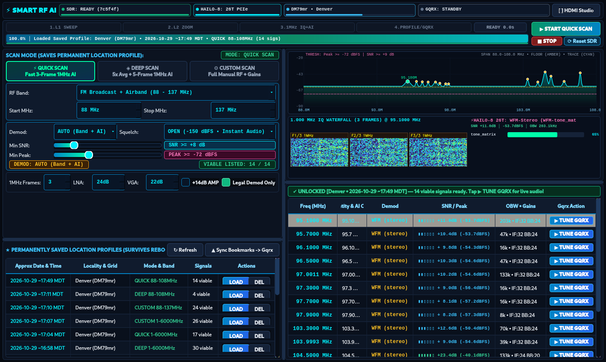
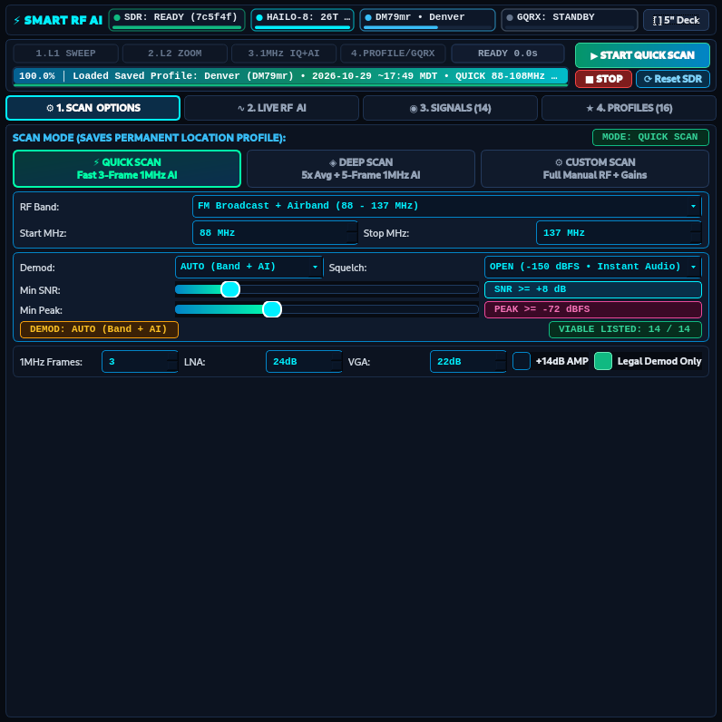
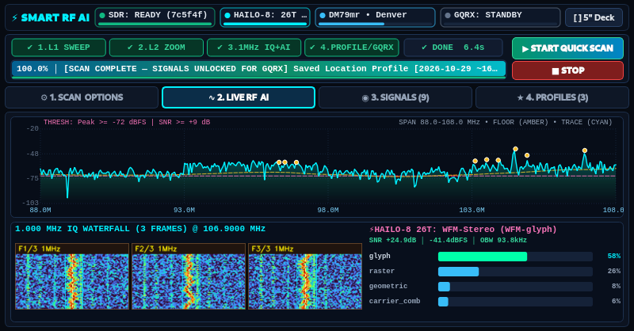
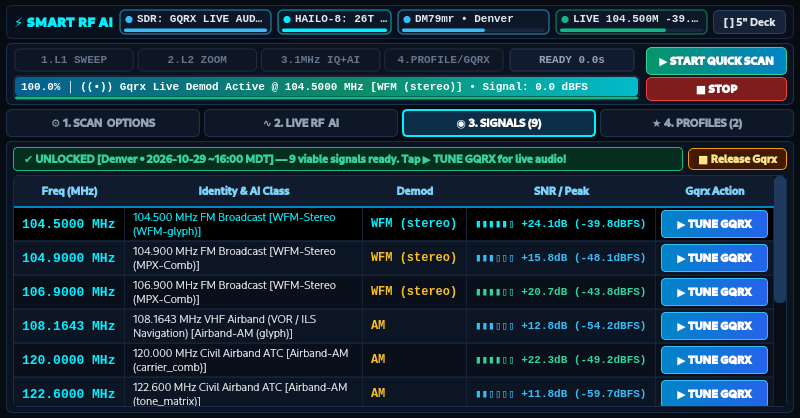
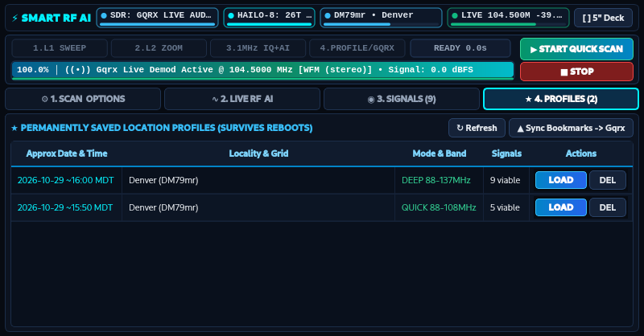
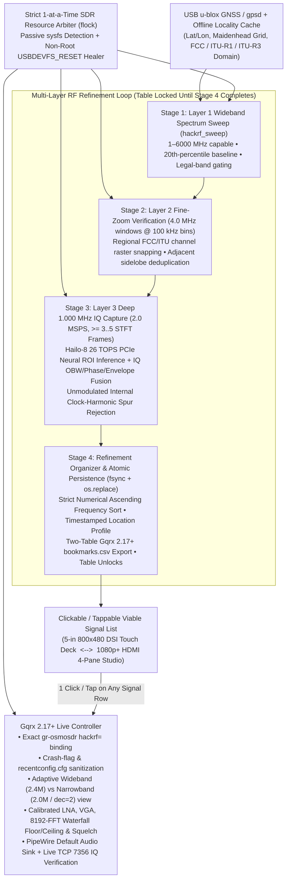

# Picto-Sight H8 (`picto-sight-h8`)

[](LICENSE)
[](#hardware--software-requirements)
[](#layer-3--1000-mhz-multi-frame-hailo-8-ai-pictogram-classification)
[-ffb300.svg)](#strict-1-at-a-time-sdr-arbiter--non-root-usb-self-healing)
[](#native-gqrx-217-profile-synthesis--verified-live-tuning)
[](#verification--test-suite)

**Picto-Sight H8** is a production-grade, hardware-accelerated **AI Smart RF Scanner, Multi-Frame Spectrogram Pictogram Classifier, and Automated Gqrx SIGINT Controller** built for **Raspberry Pi 5** equipped with a **Hailo-8 (26 TOPS PCIe) AI Accelerator**, **HackRF One SDR**, and **USB u-blox GNSS** receiver.

It executes a **4-stage multi-layer zoom-refinement RF scanning loop**—sweeping from wideband spectrum overview down to **1.000 MHz bandwidth** with **$\ge 3$ to $5$ independent 2D spectrogram frames per candidate carrier** classified on the Hailo-8 NPU—and produces a **numerically ordered, 1-click/1-tap frequency table** plus **reboot-persistent GPS Location Profiles** that configure, launch, and live-tune **Gqrx** with calibrated LNA/VGA gains, modulation/passband filters, waterfall floor/ceiling bounds, squelch, and live PipeWire audio.

---

## Visual Overview

### 1080p+ HDMI 4-Pane SIGINT Studio Mode
Automatically activates when an external HDMI monitor ($\ge 1024 \times 640$) is connected:



### 5-Inch `800×480` DSI Multitouch Field Deck Mode
Automatically adapts to compact portable SDR cyberdecks without clipping controls or requiring tiny scroll targets:

| Scan Modes, SDR Reset & Demod Thresholds | Live Wideband RF Trace & 3-Frame 1 MHz AI Strip |
| :---: | :---: |
|  |  |
| **Unlocked Clickable Signal Table & Live Gqrx Telemetry** | **Reboot-Persistent GPS Location Profiles** |
|  |  |

---

## System Architecture & 4-Stage Multi-Layer Classification Loop



---

## Key Engineering Highlights

### 1. Multi-Layer Zoom-Refinement Pipeline (`core/scanner_pipeline.py`)
- **Stage 1 — Layer 1 Wideband Overview**: Sweeps the selected preset or custom span (`1 MHz – 6000 MHz` supported on HackRF One) using `SIGINT`-safe `hackrf_sweep` orchestration, computes a robust 20th-percentile spectral noise floor, enforces user-configurable **Min SNR** and **Min Peak Power** gates, and cross-references regional bandplans (`FCC_US`, `ITU_R1`, `ITU_R3`) to flag legally demodulatable signals.
- **Stage 2 — Layer 2 `4.0 MHz` Fine-Zoom Verification**: Re-sweeps localized `4.0 MHz` neighborhoods at `100 kHz` resolution (`1–6000 MHz`), merges multi-bin wideband skirts, and snaps center frequencies to regional channel rasters (`200 kHz` odd-tenth FM broadcast channels in North America, `25 kHz` VHF Airband/Marine/NOAA, `12.5 kHz` UHF LMR/Amateur).
- **Stage 3 — Layer 3 `1.000 MHz` Multi-Frame Hailo-8 AI Pictogram Classification**:
  - Captures raw `2.0 MSPS` 8-bit quadrature IQ (`hackrf_transfer`, with automatic `-150 kHz` digital LO offset below `10 MHz` to avoid HackRF MAX2837 zero-IF DC spikes) and slices **at least 3 independent `1.000 MHz` 64×128 Hann-windowed STFT spectrogram frames** (`3` frames in Quick/Custom mode, `5` frames in Deep mode).
  - Extracts 2D spectral-floor carrier ROIs and rolling waterfall transient ROIs (`core/hailo_pictogram.py`), normalizes them into `224×224×3` Viridis tensors, and executes hardware-accelerated feature extraction on `/dev/hailo0` (**Hailo-8 26 TOPS PCIe**) paired with the bundled BatchNorm + MLP spectrogram transfer head (`models/hailo_pictogram_head_weights.npz`).
  - Fuses neural class probabilities (`carrier_comb`, `tone_matrix`, `geometric`, `glyph`, `raster`, `noise_reject`) across all evaluated frames with physical-layer IQ measurements (99% Occupied Bandwidth, instantaneous FM phase deviation vs. AM envelope depth, duty cycle) while automatically rejecting unmodulated internal clock spurs (`10 / 20 / 25 / 32 / 40 / 48 / 50 / 80 / 100 / 125 MHz` integer harmonics).
- **Stage 4 — Numerical Refinement & Atomic Location Profiles**:
  - Orders verified signals strictly in **ascending numerical frequency order**, renders side-by-side 3-to-5-frame annotated spectrogram PNG strips, atomically persists a timestamped **Location Profile** (`profiles/<Locality>_<Grid>_<YYYY-MM-DD_HH-MM-SS>_<MODE>.json`), exports spec-compliant two-table Gqrx `bookmarks.csv` files, and **unlocks** the UI signal table (`🔒 LIST LOCKED` $\rightarrow$ `🔓 CLICK ANY ROW TO TUNE GQRX`).

### 2. Strict 1-at-a-Time SDR Arbiter & Non-Root USB Self-Healing (`core/sdr_arbiter.py`)
- **Zero Contention (`fcntl.flock`)**: Enforces exclusive cross-process ownership (`/tmp/smart_rf_sdr.lock`) across `hackrf_sweep`, `hackrf_transfer`, and `gqrx`. Starting a scan cleanly stops Gqrx first; clicking a signal row verifies the scanner pipeline holds zero SDR handles before launching or live-retuning Gqrx.
- **Zero-USB-Traffic Passive Detection**: Background UI telemetry polls Linux `sysfs` (`/sys/bus/usb/devices/*/idVendor=1d50, idProduct=6089`) instead of spawning `hackrf_info`, ensuring zero libusb control-transfer collisions while Gqrx is actively streaming IQ samples.
- **Automatic & 1-Tap Non-Root `USBDEVFS_RESET`**: If the HackRF One LPC43xx SGPIO bulk endpoint ever stalls after rapid process handoffs, Picto-Sight H8 issues a kernel `USBDEVFS_RESET` (`0x5514`) ioctl directly on `/dev/bus/usb/<BUS>/<DEV>` via standard `plugdev` permissions (no `sudo` prompt required)—both automatically before sweeps/Gqrx launches and on-demand via the **`⟳ Reset SDR`** button.

### 3. Native Gqrx 2.17+ Profile Synthesis & Verified Live Tuning (`core/gqrx_controller.py`)
- **Exact `gr-osmosdr` Serial Suffix Matching**: Automatically strips leading `00000000` padding from 32-hex HackRF serial numbers (`0000000000000000458863c82f7c5f4f` $\rightarrow$ `hackrf=7c5f4f`) so `libhackrf`'s suffix matcher opens the exact board reliably every time.
- **Crash-Dialog & Config Sanitization**: Clears stale `crash=true` flags across `~/.config/gqrx/*.conf`, prunes deleted profile paths from `recentconfig.cfg`, and preserves the operator's `[gui]` window geometry and dock state.
- **Adaptive Wideband vs. Narrowband Spectrogram Geometry**:
  - **Wideband (`WFM_ST` / `WFM`)**: `2.4 MSPS` (`decimation=1`) for clean 200 kHz broadcast stereo multiplex fidelity and RDS decoding.
  - **Narrowband (`AM` / `FM` / `USB` / `LSB` / `CW`)**: `2.0 MSPS` with `decimation=2` (`1.0 MHz` visible span) and `8192`-point FFT (`25 fps`), making `6–25 kHz` voice/telemetry carriers crisp and immediately centered.
- **Calibrated Waterfall Bounds, Gains & Live Audio**: Synthesizes optimal LNA (`0–40 dB`, 8 dB steps), IF VGA (`0–62 dB`, 2 dB steps), `8192`-bin FFT waterfall floor/ceiling (`-96..-22 dBFS`), squelch (`OPEN -150 dBFS`, `AUTO` floor+margin, or custom slider override), and PipeWire default sink audio at `0 dB` (`gain=0` in Gqrx `0.1 dB` units).
- **Live TCP `127.0.0.1:7356` IQ Stream Verification**: Every click/tap verifies live DSP demodulation via Gqrx's remote-control socket (`f`, `M`, `L`, `l STRENGTH` > `-120 dBFS`), seamlessly fast-switching already-open Gqrx instances when sample rate and gains match—or performing an automated USB reset + clean relaunch if a cold start is needed.

---

## Hardware & Software Requirements

### Recommended Hardware
- **Host SBC**: Raspberry Pi 5 (4 GB or 8 GB RAM) running Raspberry Pi OS (Bookworm or Trixie, 64-bit ARM64) or Ubuntu/Debian Linux (`x86_64` / `aarch64`)
- **AI Accelerator**: Raspberry Pi AI HAT+ / M.2 HAT+ with **Hailo-8 (26 TOPS)** or **Hailo-8L (13 TOPS)** PCIe NPU *(includes automatic CPU fallback if no Hailo NPU is detected)*
- **SDR Transceiver**: Great Scott Gadgets **HackRF One** (`1 MHz – 6 GHz`, USB 2.0)
- **GNSS Receiver *(optional)***: USB **u-blox** GPS/GNSS dongle (`/dev/ttyACM*` or `gpsd` on `127.0.0.1:2947`; falls back gracefully to cached GPS locality / offline regional defaults)
- **Displays *(single or dual)***:
  - 5-inch `800×480` DSI multitouch screen (portable cyberdeck mode)
  - 1080p+ HDMI monitor (full 4-pane SIGINT Studio mode)

### System Packages
- `hackrf` (`hackrf_info`, `hackrf_sweep`, `hackrf_transfer`)
- `gqrx-sdr` (Gqrx 2.17+)
- `hailo-all` (`hailort`, `python3-hailort`, `hailo-models` providing `/usr/share/hailo-models/resnet_v1_50_h8l.hef` or `resnet_v1_50_h8.hef`)
- `gpsd`, `gpsd-clients`
- `python3-pyqt6`, `python3-pyqt6.qtsvg`, `python3-opencv`, `python3-numpy`, `python3-serial`, `pulseaudio-utils` (PipeWire `pactl`)

---

## Quick Start & Installation

Clone the repository and run the automated installer:

```bash
git clone https://github.com/DynoGator/picto-sight-h8.git
cd picto-sight-h8
chmod +x install.sh
./install.sh
```

`install.sh` performs four steps:
1. Installs required Debian / Raspberry Pi OS packages (`hackrf`, `gqrx-sdr`, `gpsd`, `python3-pyqt6`, `python3-opencv`, `hailo-all`).
2. Creates a `.venv` virtual environment with `--system-site-packages` (so `hailo_platform` and system Wayland/Qt6 plugins work out-of-the-box) and verifies `plugdev` / `dialout` group membership.
3. Installs four 1-tap Desktop & Application Menu launchers (`Picto-Sight H8 RF Scanner`, `Quick RF Location Scan`, `Deep AI RF Location Scan`, `Custom RF Profile Scan`).
4. Installs the Wayland / `labwc` XDG boot autostart entry (`~/.config/autostart/smart-ai-rf-scanner.desktop`).

> **Custom Install Flags**: Pass `--no-apt` to skip `apt-get`, `--no-desktop` to skip Desktop icons, or `--no-autostart` to disable boot autostart.

---

## Usage Guide

### Launching the Graphical SIGINT Cockpit
```bash
# Open the adaptive GUI (auto-detects 800x480 DSI Touch vs 1080p+ HDMI Studio)
./launch_scanner.sh --gui

# Launch GUI (or signal an already-running GUI via UNIX IPC) and immediately start a scan:
./launch_scanner.sh --gui --auto-scan quick
./launch_scanner.sh --gui --auto-scan deep
./launch_scanner.sh --gui --auto-scan custom
```

### Headless CLI Scanning & Instant Gqrx Tuning
```bash
# Run a Quick multi-layer AI scan (88–163 MHz default) and save a permanent Location Profile
./launch_scanner.sh --scan --mode quick

# Run a Deep 5-frame 1.000 MHz Hailo-8 AI scan over a custom frequency span
./launch_scanner.sh --scan --mode deep --start-mhz 88 --stop-mhz 470 --min-snr 9.0

# List all saved reboot-persistent Location Profiles
./launch_scanner.sh --list-profiles

# Tune Gqrx directly to Signal #1 from the latest saved profile with live audio & verified IQ
./launch_scanner.sh --tune-index 1

# Tune Gqrx directly to a specific frequency (MHz) using its classified profile settings
./launch_scanner.sh --tune-mhz 107.9
```

### Importing Bookmarks Directly Inside Gqrx
Every completed scan automatically updates `~/.config/gqrx/bookmarks.csv` and archives a per-profile `<Profile_ID>_bookmarks.csv` inside `profiles/` using Gqrx 2.17's native two-table semicolon format (band color tags + frequency/demod/bandwidth entries) so every classified signal appears immediately in Gqrx's **Bookmarks** dock and waterfall tags.

---

## Repository Structure

```text
picto-sight-h8/
├── LICENSE                                  # MIT License
├── README.md                                # Project architecture & operator documentation
├── pyproject.toml                           # Package metadata & pytest configuration
├── requirements.txt                         # Python package dependencies
├── install.sh                               # Automated Raspberry Pi 5 / Linux setup script
├── smart_scanner_cli.py                     # CLI & single-instance PyQt6 GUI entry point
├── launch_scanner.sh                        # Wayland/X11 environment launcher
├── autostart_scanner.sh                     # Boot autostart supervisor for Wayland / labwc
├── core/
│   ├── bandplans.py                         # FCC / ITU-R1 / ITU-R3 bandplans, channel snapping & FFT bounds
│   ├── gps_engine.py                        # USB u-blox GNSS NMEA + gpsd & offline locality cache
│   ├── gqrx_controller.py                   # Native Gqrx 2.17+ INI synthesizer, PipeWire & TCP 7356 controller
│   ├── hackrf_engine.py                     # SIGINT-safe HackRF sweep, 2 MSPS IQ capture & clock-spur filter
│   ├── hailo_pictogram.py                   # Hailo-8 (26 TOPS PCIe) VDevice driver, ROI extractor & MLP head
│   ├── pictogram_engine.py                  # Multi-frame (>=3..5 x 1 MHz) neural + IQ modulation fusion engine
│   ├── profile_organizer.py                 # Numerical frequency organizer, atomic JSON & Gqrx CSV exporter
│   ├── scanner_pipeline.py                  # 4-stage multi-layer zoom-refinement scanning orchestrator
│   └── sdr_arbiter.py                       # Cross-process flock SDR arbiter, sysfs probe & USBDEVFS_RESET healer
├── ui/
│   ├── main_window.py                       # Adaptive 5" DSI Touch Deck <-> 1080p+ HDMI 4-Pane SIGINT Studio
│   ├── styles.py                            # High-contrast dark tactical Qt6 stylesheet
│   └── widgets.py                           # Wideband RF trace, 3-frame AI waterfall strip & segmented gauges
├── models/
│   └── hailo_pictogram_head_weights.npz     # Calibrated BatchNorm + MLP spectrogram transfer-head weights
├── icons/                                   # Custom SVG vector application & scan-mode icons
├── desktop/                                 # Parameterized XDG .desktop & boot autostart templates
├── docs/images/                             # High-resolution HDMI Studio & 5" DSI Touch screenshots
├── profiles/                                # Runtime saved Location Profiles (gitignored for GPS privacy)
├── export/                                  # Runtime Gqrx bookmarks & JSON exports (gitignored)
└── tests/                                   # 22 unit & live hardware integration tests
```

---

## Verification & Test Suite

Run the complete unit and hardware integration test suite with `pytest`:

```bash
./.venv/bin/python -m pytest -v
```

The test suite verifies:
- Passive `sysfs` HackRF detection, `gr-osmosdr` serial suffix formatting (`hackrf=<suffix>`), non-root `USBDEVFS_RESET` recovery, and `recentconfig.cfg` / `crash=false` sanitization ([`tests/test_smart_scanner_v2.py`](tests/test_smart_scanner_v2.py))
- `8192`-FFT waterfall floor/ceiling normalization, low-HF (`< 10 MHz`) `-150 kHz` LO offset, internal clock-spur rejection, and `1–6000 MHz` bin-width scaling ([`tests/test_bandplans.py`](tests/test_bandplans.py), [`tests/test_smart_scanner_v2.py`](tests/test_smart_scanner_v2.py))
- USB u-blox GNSS NMEA parsing, Maidenhead grid calculation, and reboot-persistent locality caching ([`tests/test_gps.py`](tests/test_gps.py))
- Live **Hailo-8 (26 TOPS PCIe)** multi-frame `1.000 MHz` spectrogram classification & composite RGB rendering ([`tests/test_pictogram.py`](tests/test_pictogram.py))
- Full 4-stage multi-layer hardware scan, strict ascending numerical frequency ordering, atomic Location Profile persistence, and live Gqrx launch + TCP `7356` DSP stream verification ([`tests/test_pipeline.py`](tests/test_pipeline.py), [`tests/test_gqrx.py`](tests/test_gqrx.py))

---

## Regulatory & Legal Notice

Picto-Sight H8 is a **receive-only** spectrum analysis and signal classification instrument (`hackrf_sweep`, `hackrf_transfer -r`, and `gqrx` RX-only). Always comply with local telecommunications and spectrum monitoring regulations (such as FCC Part 15 / ECPA in the United States or equivalent national ITU regulations). Built-in regional bandplans automatically gate cellular/restricted allocations from demodulation profiles.

---

## License

Released under the [MIT License](LICENSE). Copyright (c) 2026 [DynoGator](https://github.com/DynoGator).
