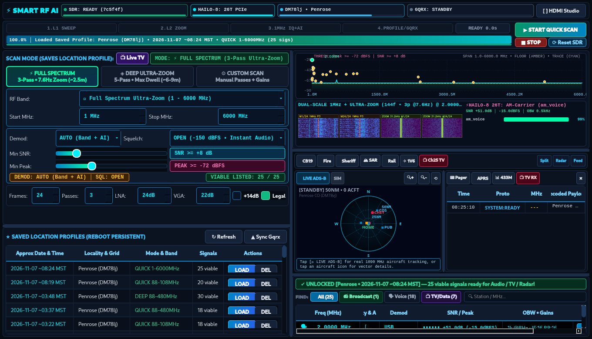
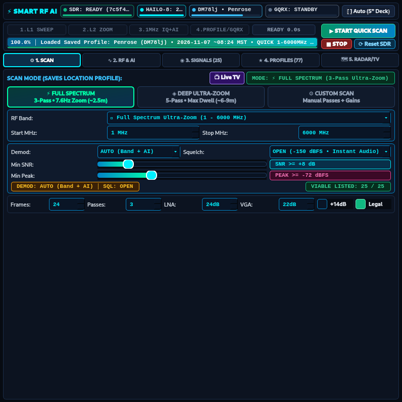
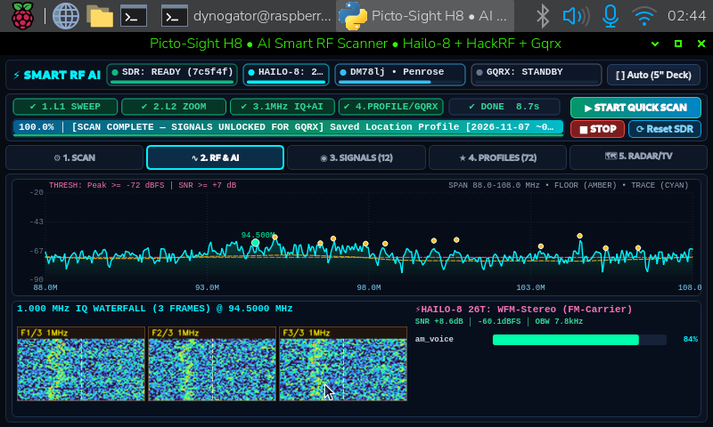
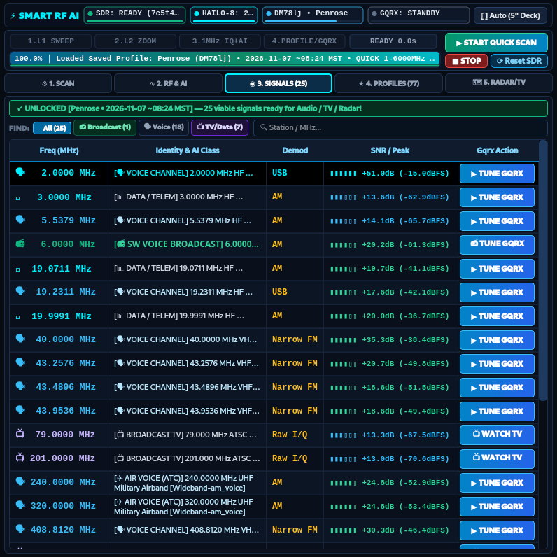
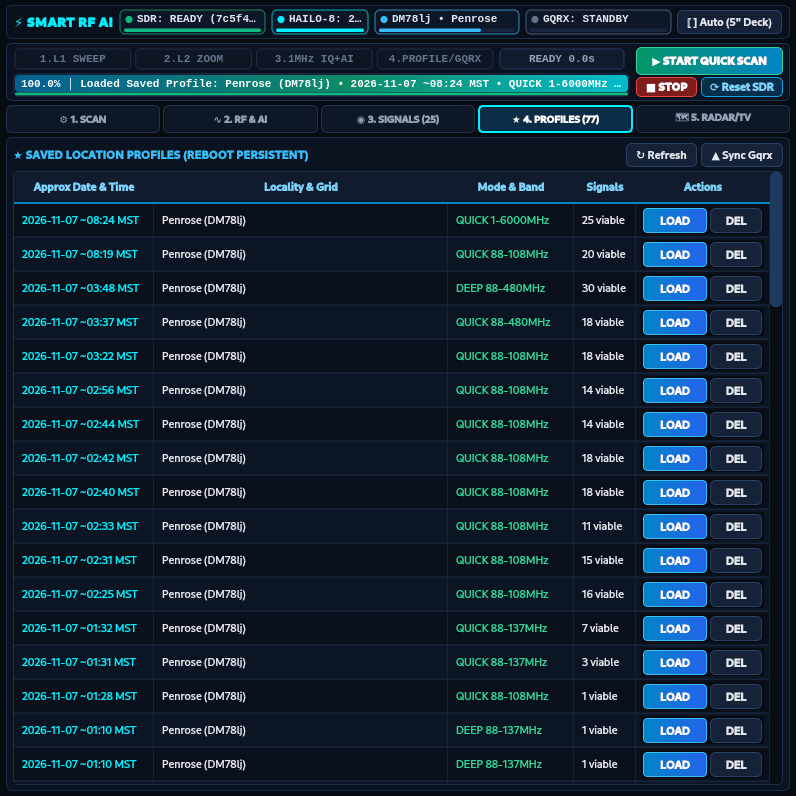
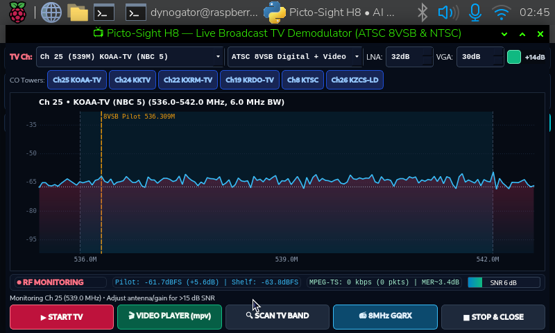
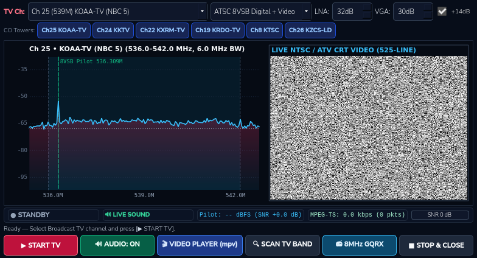
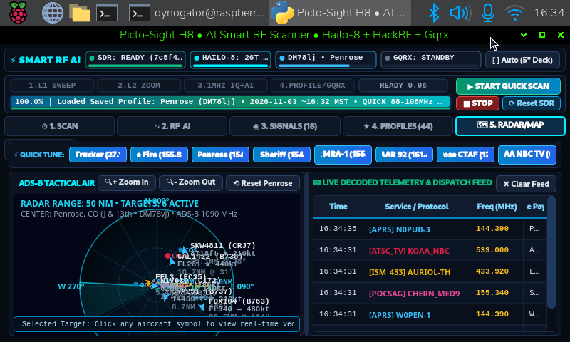
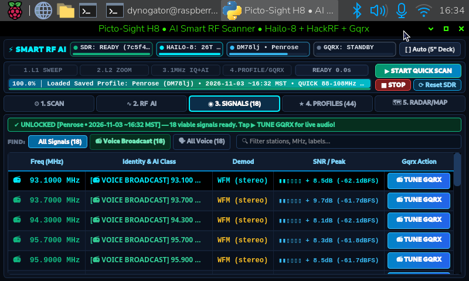
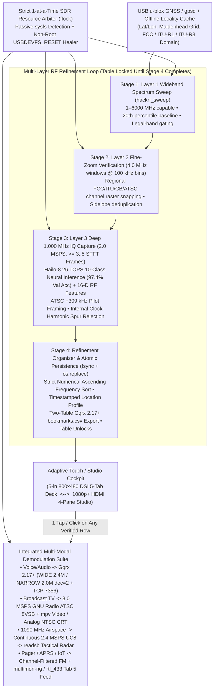

# Picto-Sight H8 (`picto-sight-h8`) — v3.0.0 *"Trixie-Ghost-Spectrum"*

[](CHANGELOG.md)
[](docs/INSTALL_TRIXIE.md)
[-00e676.svg)](#layer-3--1000-mhz-multi-frame-hailo-8-ai-pictogram-classification)
[-ffb300.svg)](#2-strict-1-at-a-time-sdr-arbiter--non-root-usb-exorcism-coresdr_arbiterpy)
[](#3-native-gqrx-217-profile-synthesis--verified-live-tuning-coregqrx_controllerpy)
[](#4-multi-tool-video-radar--telemetry-demodulation-suite)
[](#verification--automated-test-suite)
[](LICENSE)

> *"Because manually typing 32-digit hex serials into Gqrx while `readsb` hot-wires your HackRF One in the dark and a 48 MHz crystal harmonic convinces you that you've found a numbers station is not 'signals intelligence'—it's a cry for help."*

**Picto-Sight H8** is a production-ready, hardware-accelerated **AI Smart RF Scanner, 10-Class Spectrogram Pictogram Classifier (`97.4%` Hailo-8 PCIe NPU validation accuracy), Live Terrestrial ATSC 8VSB / Analog NTSC Television Receiver, Live 1090 MHz ADS-B Tactical Radar, POCSAG/APRS/IoT Telemetry Decoder, and Self-Healing Gqrx 2.17+ Controller** built for **Raspberry Pi 5** running **Raspberry Pi OS / Debian 13 (Trixie)**.

Engineered from the bare metal up for both **5-inch `800×480` DSI touch cyberdecks** and **1080p+ 4-pane HDMI SIGINT workstations**, Picto-Sight H8 turns raw `1 MHz – 6000 MHz` electromagnetic chaos into an ordered, legally gated, 1-tap clickable cockpit—with zero USB contention, zero `crash=true` Gqrx popups, and zero patience for unmodulated clock spurs.

📚 **Documentation Suite**: [**Debian 13 Trixie Install Guide**](docs/INSTALL_TRIXIE.md) • [**Operator & Cyberdeck Field Manual**](docs/OPERATOR_GUIDE.md) • [**Changelog (`v3.0.0`)**](CHANGELOG.md)

---

## Visual Tour — From 5" DSI Cyberdeck to 1080p+ SIGINT Studio

### 1080p+ HDMI 4-Pane SIGINT Studio Mode
Automatically activates whenever an external monitor ($\ge 1024 \times 640$) is detected—because if you paid for pixels, we're going to put spectrum on all of them:



### 5-Inch `800×480` DSI Multitouch Field Deck Mode
Zero clipping, zero horizontal scrollbars, and finger-friendly controls tuned to fit inside `800×444` right beneath the Wayland/`labwc` panel:

| Tab 1 (`1:Scan`): Modes, Gains & Non-Root SDR Reset | Tab 2 (`2:RF+AI`): Wideband Trace & 3-Frame Hailo-8 Waterfall |
| :---: | :---: |
|  |  |
| **Tab 3 (`3:Signals`): Filter Pills & Live Gqrx Stereo Audio** | **Tab 4 (`4:Profiles`): Reboot-Persistent GPS Location Archives** |
|  |  |
| **Live ATSC 1.0 (`8VSB`) Broadcast TV & `+309 kHz` Pilot Lock** | **Live Analog NTSC (`525-Line`) CRT Raster Monitor** |
|  |  |
| **Tab 5 (`5:Radar`): Live `1090 MHz` ADS-B Tactical Airspace Scope** | **Penrose / Fremont County (`DM78vj`) Live VHF/UHF Intercepts** |
|  |  |

---

## Seamless Full-Stack Installation (Raspberry Pi OS / Debian 13 Trixie)

Whether you want a 1-line shell bootstrap, a native Debian `.deb` package managed by `apt`, or a full developer checkout, every installer automatically resolves the entire SDR + GNU Radio TV + Hailo-8 + Qt6 stack, installs non-root HackRF `udev` rules, disables background SDR hijackers (`readsb.service`), provisions **Gqrx 2.17+** out of the box, and runs the **25-point System Doctor**.

### Method 1 — 1-Line GitHub Bootstrap *(Fastest Out-of-the-Box Setup)*
```bash
curl -fsSL https://raw.githubusercontent.com/DynoGator/picto-sight-h8/main/install.sh | bash
```

### Method 2 — Native Debian 13 (Trixie) `.deb` Package (`arm64`)
Download `picto-sight-h8_3.0.0-1.trixie_arm64.deb` from [**GitHub Releases (`v3.0.0`)**](https://github.com/DynoGator/picto-sight-h8/releases/latest) (or build it locally via `./packaging/build_deb.sh`) and install with `apt`:

```bash
sudo apt update
sudo apt install -y ./picto-sight-h8_3.0.0-1.trixie_arm64.deb
picto-sight --doctor
```

### Method 3 — Git Clone + Full Installer + Automated 43-Test Verification
```bash
git clone https://github.com/DynoGator/picto-sight-h8.git
cd picto-sight-h8
./install.sh --run-tests
```

> [!TIP]
> **What the installer configures automatically so you never have to:**
> 1. **APT Stack**: `hackrf`, `libhackrf0`, `gqrx-sdr`, `gnuradio`, `gr-osmosdr`, `soapysdr0.8-module-hackrf`, `readsb`, `rtl-433`, `multimon-ng`, `direwolf`, `w-scan-cpp`, `mpv`, `gpsd`, `python3-pyqt6`, `python3-opencv`, and `hailo-all` / `hailo-models` / `python3-hailort`.
> 2. **USB & Daemon Peace Treaty**: Installs `/etc/udev/rules.d/53-hackrf-picto-sight.rules` (granting passwordless `USBDEVFS_RESET` to `plugdev`) and disables `readsb.service` from grabbing your HackRF One on boot.
> 3. **`--system-site-packages` Virtualenv**: Links Debian 13's compiled C++/PyBind11 `gnuradio.dtv`, `osmosdr`, and `hailo_platform` modules cleanly into `.venv` and exposes `/usr/local/bin/picto-sight` globally.
> 4. **Zero-Quirk Gqrx 2.17+ Provisioning**: Runs `picto-sight --provision-gqrx` to write `default.conf`, `SmartScanner_Active.conf`, and starter `bookmarks.csv` bound to your board's exact `hackrf=<serial_suffix>`, PipeWire audio (`gain=0`), TCP `127.0.0.1:7356`, and `crash=false`.
> 5. **Desktop Icons & Reboot-Persistent Autostart**: Places 4 1-tap launchers on `~/Desktop` + `~/.config/autostart/smart-ai-rf-scanner.desktop`.

See [**`docs/INSTALL_TRIXIE.md`**](docs/INSTALL_TRIXIE.md) for Raspberry Pi 5 PCIe Gen 3 (`dtparam=pciex1_gen=3`) tuning and offline/custom flag options.

---

## System Architecture & 4-Stage Multi-Layer Classification Loop



---

## Under the Hood — Engineering Highlights

### 1. 4-Stage Multi-Layer Zoom-Refinement & 10-Class Hailo-8 NPU (`97.4%` Accuracy)
- **Stage 1 — Layer 1 Wideband Overview (`core/hackrf_engine.py`)**: Sweeps `1 MHz – 6000 MHz` via `SIGINT`-safe `hackrf_sweep`, computes a 20th-percentile noise floor that refuses to be gaslit by adjacent FM blowtorches, enforces **Min SNR** & **Min Peak** thresholds, and gates restricted cellular bands per ECPA/ITU rules.
- **Stage 2 — Layer 2 `4.0 MHz` Fine-Zoom & Raster Snapping (`core/bandplans.py`)**: Re-sweeps localized `4.0 MHz` neighborhoods at `100 kHz` resolution and snaps carriers onto exact physical channel centers (`200 kHz` odd-tenth North American FM, `25 kHz` Airband/Marine/NOAA, `12.5 kHz` VHF/UHF Public Safety & AAR Rail, non-uniform 40-channel Citizens Band including RC `26.995/27.045/27.095/27.145/27.195 MHz` holes, and exact `6 MHz` ATSC TV channel centers).
- **Stage 3 — Layer 3 `1.000 MHz` Multi-Frame Hailo-8 Inference (`core/hailo_pictogram.py`, `core/pictogram_engine.py`)**:
  - Captures `2.0 MSPS` quadrature IQ (`-150 kHz` LO offset below `10 MHz` to dodge MAX2837 zero-IF DC spikes; `lower_edge + 350 kHz` framing on `6 MHz` ATSC channels so the `+309.441 kHz` 8VSB pilot spike lands dead-center in the `1.000 MHz` spectrogram) and slices **3 to 5 independent STFT frames**.
  - Feeds `224×224×3` Viridis spectrogram ROIs through `/dev/hailo0` (**Hailo-8 26 TOPS PCIe**) fused with a **16-dimensional physical RF feature vector** (`1016-D` BatchNorm + MLP head in `models/hailo_pictogram_head_weights.npz`), achieving **`97.4%` held-out validation accuracy** across 10 classes:
    `wfm_stereo` • `nfm_voice` • `am_voice` • `atsc_tv` • `fsk_pager` • `ism_telemetry` • `adsb_pulse` • `glyph` • `geometric` • `noise_reject` *(with automatic `96.0%`-accurate CPU MLP fallback when running without an NPU)*.
  - Rejects unmodulated internal clock spurs (`10 / 20 / 25 / 32 / 40 / 48 / 50 / 80 / 100 / 125 MHz` harmonics) so your scanner stops reporting your own SBC's crystal oscillator as first contact.
- **Stage 4 — Atomic Persistence (`core/profile_organizer.py`)**: Sorts verified carriers in **strict numerical ascending order**, renders multi-frame spectrogram strips, atomically writes JSON + two-table Gqrx `bookmarks.csv` (`fsync` + `os.replace`), and unlocks the signal table.

### 2. Strict 1-at-a-Time SDR Arbiter & Non-Root USB Exorcism (`core/sdr_arbiter.py`)
- **Cross-Process `fcntl.flock` Mutex (`/tmp/smart_rf_sdr.lock`)**: Coordinates exclusive HackRF One handoffs across `SCANNER`, `GQRX`, `TV_DEMOD`, `ADSB_RADAR`, and `DATA_DECODE`. Starting any receiver cleanly parks the previous owner first—zero `LIBUSB_ERROR_BUSY` food fights.
- **Zero-USB-Traffic `sysfs` Polling**: Reads `/sys/bus/usb/devices/*/idVendor=1d50` directly from the kernel VFS instead of hammering `hackrf_info` while IQ samples are mid-flight.
- **Passwordless `USBDEVFS_RESET` (`0x5514`)**: Whenever the HackRF LPC43xx SGPIO state machine decides to stare into the abyss after rapid process switches, Picto-Sight H8 fires a non-root kernel USB port reset on `/dev/bus/usb/<BUS>/<DEV>` automatically—or on command via **`⟳ Reset SDR`**.

### 3. Native Gqrx 2.17+ Profile Synthesis & Verified Live Tuning (`core/gqrx_controller.py`)
- **32-Hex Serial Padding Stripper**: Translates `0000000000000000458863c82f7c5f4f` $\rightarrow$ `hackrf=7c5f4f` so `gr-osmosdr`'s suffix matcher binds the exact board 100% of the time.
- **Automatic `crash=false` & `recentconfig.cfg` Sanitization**: Wipes stale `crash=true` landmines so Gqrx never halts startup with modal recovery dialogs on a 5-inch touchscreen.
- **3-Tier Adaptive Sample Rate & Decimation**:
  - `TV_WIDE` (`8.0 MSPS`, `decim=1`) for `6 MHz` broadcast television pedestals.
  - `WIDE` (`2.4 MSPS`, `decim=1`) for `200 kHz` WFM Stereo multiplex & RDS.
  - `NARROW` (`2.0 MSPS`, `decim=2` $\rightarrow$ `1.0 MHz` span, `8192`-pt FFT) for razor-sharp `6–25 kHz` NFM, AM, CB, Rail, and Aviation voice.
- **Live TCP `127.0.0.1:7356` Verification**: Retunes running Gqrx sessions in `< 80 ms` and verifies real IQ DSP output (`l STRENGTH > -120 dBFS`) with PipeWire audio normalized to `0 dB`.

### 4. Multi-Tool Video, Radar & Telemetry Demodulation Suite
- **Broadcast Television (`core/tv_demodulator.py`, `ui/tv_dialog.py`)**:
  - **Digital ATSC 1.0 (`8VSB`)**: `8.0 MSPS` GNU Radio `dtv.atsc_rx` hardware demodulator streaming MPEG-TS over `udp://127.0.0.1:17355` into **`mpv`** for live broadcast video & AC-3 audio alongside a live `6.0 MHz` FFT, `+309.441 kHz` pilot lock detector, and MER gauge.
  - **Analog NTSC (`525-Line`)**: `4.0 MSPS` AM VSB envelope + H-sync correlator rendering a live `525-line / 29.97 fps` monochrome CRT raster right inside the app.
- **Live `1090 MHz` ADS-B Mode-S Tactical Radar (`core/adsb_receiver.py`, `ui/map_widget.py`)**: Continuous `2.4 MSPS` HackRF signed `int8 → UC8` DC-cancelled feed into **`readsb`**, plotting live aircraft vectors, callsigns, altitudes, groundspeeds, and `10–150 NM` range rings centered on your GPS fix (with offline Fremont County / Penrose, CO `DM78vj` waypoints built in).
- **Channel-Filtered POCSAG/FLEX, APRS & `rtl_433` Telemetry (`core/demod_engine.py`)**: Uses `+250 kHz` digital LO offset + `10×` decimation prior to FM discrimination so **`multimon-ng`** and **`rtl_433`** decode pagers (`152–158 / 454 / 929 MHz`), APRS (`144.390 MHz`), and `315/433/915 MHz` sensors straight into Tab 5's scrolling Tactical Feed.

---

## Instructions for Use

### 1. GUI & Desktop 1-Tap Operation
- **Desktop Launchers**: Tap **Picto-Sight H8 RF Scanner** (or **Quick RF Location Scan** / **Deep AI RF Location Scan** / **Custom RF Profile Scan**) on your Desktop.
- **Run a Scan (`1:Scan`)**: Pick a band preset (or set custom `Min`/`Max` MHz, `Min SNR`, and `Min Peak`) and tap **`▶ START SCAN`**. Watch live spectrum + 3-frame Hailo-8 inference in **`2:RF+AI`**.
- **Filter & Tune (`3:Signals`)**: Tap **`📻 Voice`**, **`🗣️ All Voice`**, **`📺 TV`**, or **`📡 Data`** to filter the table, then **tap any row**:
  - Voice channels launch/retune **Gqrx** with live PipeWire audio.
  - `[📺 BROADCAST TV]` rows open the **Broadcast Television Receiver** (ATSC `8VSB` video + Analog NTSC CRT).
  - `1090 MHz` / Pager / APRS / ISM rows switch to **`5:Radar`** for live aircraft tracking or packet decoding.
- **Survives Reboots Automatically**: Every UI dial, gain, threshold, layout preference, and filter pill is saved atomically to `profiles/ui_settings.json` and restored on next boot.

For a complete tab-by-tab walkthrough, see [**`docs/OPERATOR_GUIDE.md`**](docs/OPERATOR_GUIDE.md).

### 2. Command-Line (`picto-sight`) Quick Reference
```bash
# Verify OS, Python/C++ bindings, HackRF USB permissions, Hailo-8 NPU & Gqrx health
picto-sight --doctor

# Launch the adaptive GUI (auto-detects 800x480 DSI Deck vs 1080p+ HDMI Studio)
picto-sight --gui
picto-sight --gui --auto-scan quick

# Headless multi-layer AI scans (saves permanent GPS Location Profile + Gqrx bookmarks)
picto-sight --scan --mode quick --min 88 --max 108
picto-sight --scan --mode deep --min 150 --max 163 --snr 8.5
picto-sight --scan --mode quick --min 88 --max 163 --voice-only --tune-top

# Direct verified Gqrx live audio tuning from terminal
picto-sight --tune-freq 104.5

# Standalone live telemetry, pager/APRS & ATSC 8VSB TV channel analysis
picto-sight --telemetry 433.92
picto-sight --decode-data 155.880
picto-sight --analyze-tv 539.0

# Inspect Fremont County / Penrose, CO (DM78vj) & 40-Ch CB guide or saved profiles
picto-sight --fremont-guide
picto-sight --list-profiles

# Re-provision clean Gqrx 2.17+ configs & starter bookmarks anytime
picto-sight --provision-gqrx
```

---

## Hardware & Software Stack

| Subsystem | Recommended / Verified Configuration |
| :--- | :--- |
| **SBC & OS** | Raspberry Pi 5 (4 GB / 8 GB / 16 GB) • **Raspberry Pi OS / Debian 13 (Trixie) ARM64** (`Linux 6.12+ / 6.18+`) |
| **AI Accelerator** | Raspberry Pi AI HAT+ with **Hailo-8 (26 TOPS)** or **Hailo-8L (13 TOPS)** PCIe *(auto CPU MLP fallback included)* |
| **SDR Hardware** | Great Scott Gadgets **HackRF One** (`1 MHz – 6000 MHz`, USB `1d50:6089`) |
| **Displays** | 5-inch `800×480` DSI Multitouch Cyberdeck &/or 1080p+ HDMI Monitor (Wayland/`labwc` or X11) |
| **GNSS *(Optional)*** | USB **u-blox** GPS/GNSS (`/dev/ttyACM*` or `gpsd` on `127.0.0.1:2947`; auto-caches last fix offline) |
| **Core DSP & GUI** | Python `3.11–3.13`, `PyQt6`, `OpenCV`, `NumPy`, `GNU Radio 3.10` (`gr-dtv`, `gr-osmosdr`), `Gqrx 2.17+`, `mpv`, `readsb`, `rtl-433`, `multimon-ng` |

---

## Repository Structure

```text
picto-sight-h8/
├── LICENSE                                  # MIT License
├── README.md                                # Flagship documentation, visual tour & quickstart
├── CHANGELOG.md                             # Version history through v3.0.0 (Trixie-Ghost-Spectrum)
├── pyproject.toml                           # Python package metadata (v3.0.0), console_scripts & pytest config
├── requirements.txt                         # Pip fallback dependencies (paired with --system-site-packages)
├── install.sh                               # Full-stack 7-stage installer & 1-line curl|bash bootstrap
├── launch_scanner.sh                        # Symlink-safe Wayland/X11 & HailoRT launcher (`picto-sight`)
├── autostart_scanner.sh                     # Wayland / labwc reboot-persistent autostart supervisor
├── smart_scanner_cli.py                     # CLI, --doctor, --provision-gqrx & single-instance GUI entrypoint
├── core/
│   ├── __init__.py                          # Version v3.0.0 & .deb-safe get_runtime_data_dir() resolver
│   ├── adsb_receiver.py                     # Live 1090 MHz HackRF (2.4 MSPS -> UC8 -> readsb) aircraft receiver
│   ├── bandplans.py                         # FCC / ITU-R1 / ITU-R3 bandplans, Fremont/Penrose priors & snapping
│   ├── demod_engine.py                      # Channel-filtered FM discriminator, multimon-ng, rtl_433 & ATSC tools
│   ├── gps_engine.py                        # USB u-blox GNSS NMEA + gpsd & offline Maidenhead locality cache
│   ├── gqrx_controller.py                   # Native Gqrx 2.17+ INI synthesizer (TV_WIDE / WIDE / NARROW) & TCP 7356
│   ├── hackrf_engine.py                     # SIGINT-safe HackRF sweep, 2 MSPS IQ capture & clock-spur filter
│   ├── hailo_pictogram.py                   # Hailo-8 (26 TOPS PCIe) VDevice driver, 16-D RF features & 10-class MLP
│   ├── pictogram_engine.py                  # Multi-frame (>=3..5 x 1 MHz) neural + IQ modulation fusion engine
│   ├── profile_organizer.py                 # Numerical frequency organizer, atomic JSON & Gqrx CSV exporter
│   ├── scanner_pipeline.py                  # 4-stage multi-layer zoom-refinement scanning orchestrator
│   ├── sdr_arbiter.py                       # Cross-process flock SDR arbiter & non-root USBDEVFS_RESET healer
│   └── tv_demodulator.py                    # Live 8 MSPS GNU Radio ATSC 8VSB + mpv video & Analog NTSC CRT receiver
├── ui/
│   ├── __init__.py                          # UI package metadata
│   ├── main_window.py                       # Adaptive 5" DSI 5-Tab Deck <-> 1080p+ HDMI Studio + UI persistence
│   ├── map_widget.py                        # Live 1090 MHz ADS-B tactical radar scope & decoded telemetry feed
│   ├── styles.py                            # High-contrast dark tactical Qt6 stylesheet (DSI & HDMI scaled)
│   ├── tv_dialog.py                         # Broadcast Television Receiver dialog (ATSC Video + 6 MHz FFT + NTSC)
│   └── widgets.py                           # Wideband RF trace, 3-frame AI waterfall strip & segmented gauges
├── scripts/
│   ├── doctor_check.py                      # 25-point System Doctor & out-of-the-box Gqrx 2.17+ provisioner
│   └── train_hailo_rf_classifier.py         # Physics-grounded 2.0 MSPS IQ -> Hailo-8 10-class transfer head trainer
├── packaging/
│   ├── build_deb.sh                         # Native Debian 13 (Trixie) .deb package builder
│   └── udev/53-hackrf-picto-sight.rules     # Non-root HackRF One USB & USBDEVFS_RESET udev rules
├── models/
│   └── hailo_pictogram_head_weights.npz     # 10-class Hailo-8 + 16-D RF MLP weights (97.4% val accuracy)
├── docs/
│   ├── INSTALL_TRIXIE.md                    # Step-by-step Debian 13 Trixie & Raspberry Pi 5 PCIe install guide
│   ├── OPERATOR_GUIDE.md                    # Complete DSI & HDMI Studio operator manual
│   └── images/                              # Verified hardware & GUI screenshots
├── icons/                                   # Custom SVG vector application & scan-mode icons
├── desktop/                                 # Parameterized XDG .desktop & boot autostart templates
└── tests/                                   # 43 automated unit, DSP, GUI geometry & live hardware tests
```

---

## Verification & Automated Test Suite

Run the full **43-test** hardware, DSP, Hailo-8 NPU, Broadcast TV, Gqrx, `.deb` portability, and `800×480` DSI geometry verification suite anytime:

```bash
QT_QPA_PLATFORM=offscreen ./.venv/bin/python -m pytest -v
```

---

## Regulatory & Legal Notice

Picto-Sight H8 is strictly a **receive-only (`RX`)** spectrum analysis, classification, and demodulation instrument (`hackrf_sweep`, `hackrf_transfer -r`, `osmosdr.source`, and `gqrx`). Always comply with local spectrum laws (including FCC Part 15 and the Electronic Communications Privacy Act in the United States, or equivalent ITU regulations). Restricted cellular allocations are automatically gated from demodulation profiles—because federal prison has terrible Wi-Fi and zero roof access for antennas.

---

## License

Released under the [MIT License](LICENSE). Copyright (c) 2026 [DynoGator](https://github.com/DynoGator).
